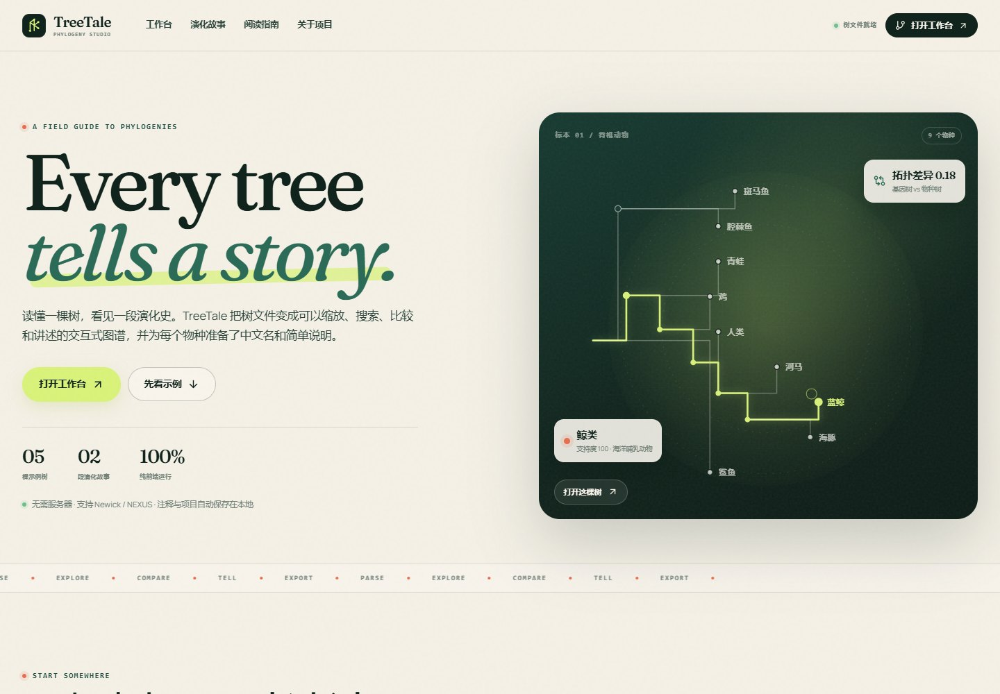
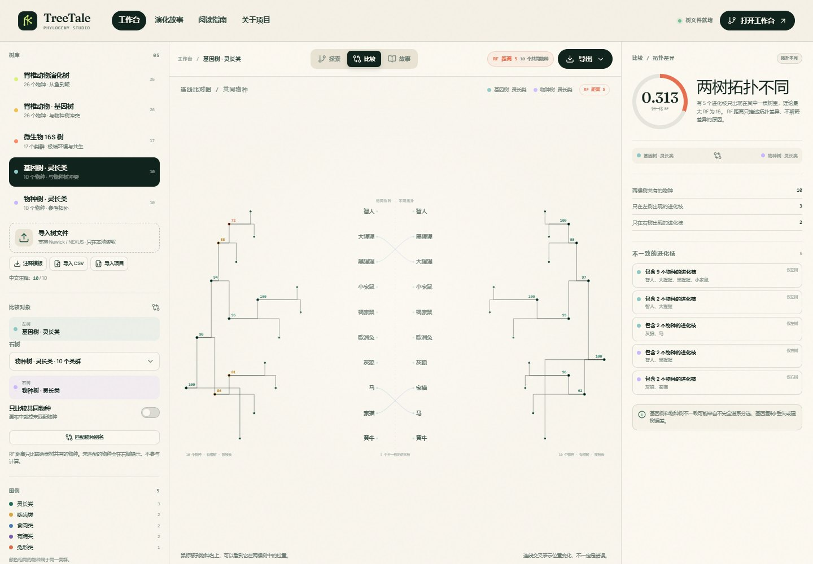
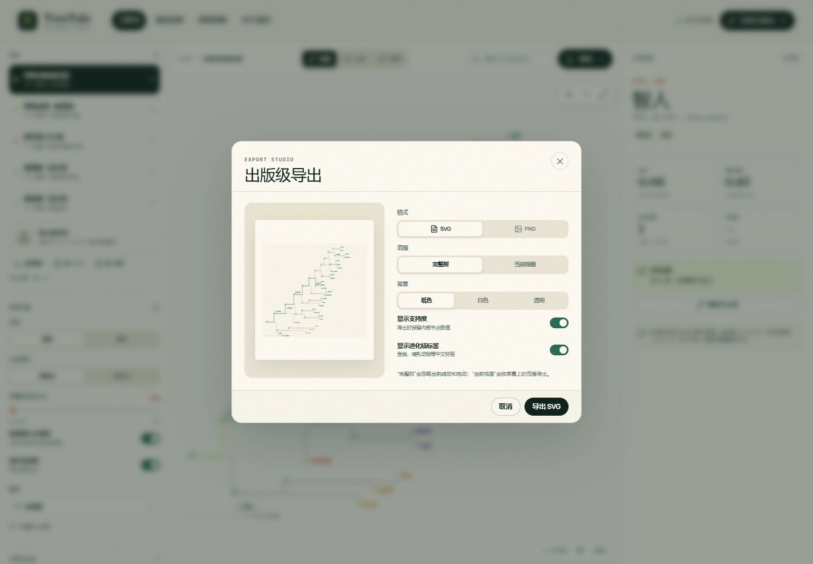
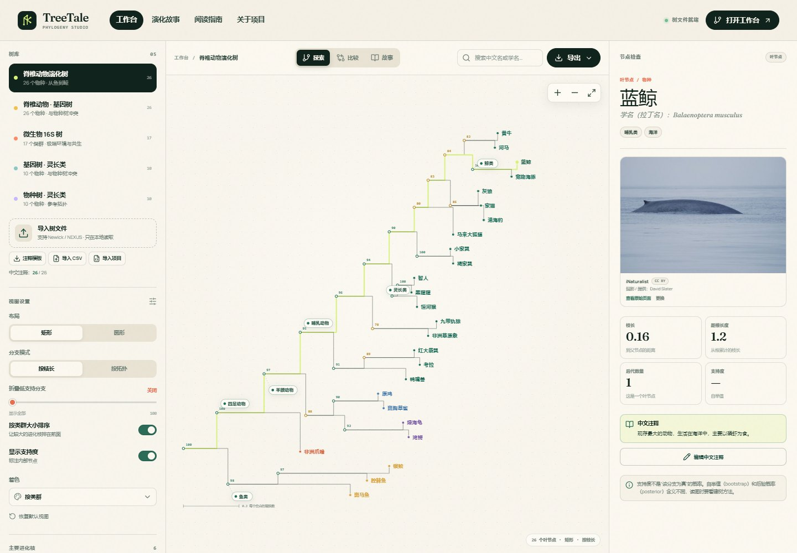
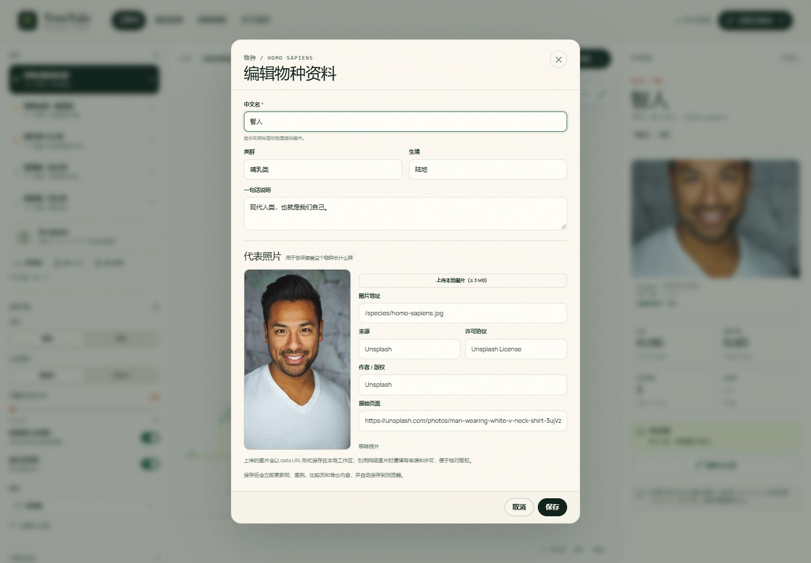
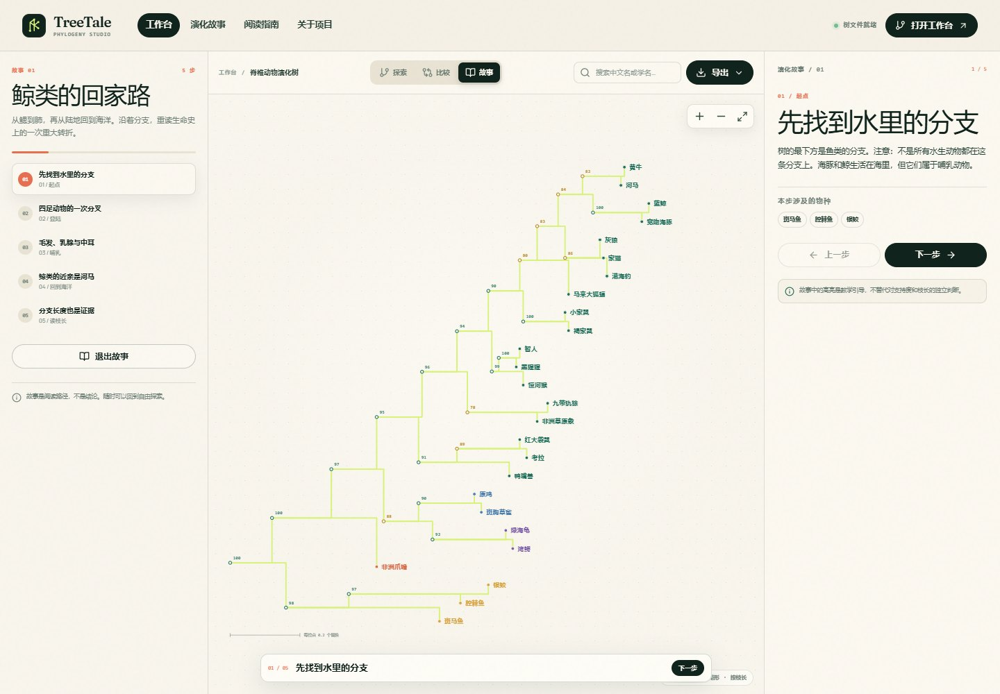

# TreeTale

> **Every tree tells a story.**  
> 把系统发育树变成可以探索、比较和讲述的交互式图谱。

**在线演示：** https://juwairenyixia.github.io/TreeTale/  
**版本：** v2.0.0 · 2026  
[](https://github.com/juwairenyixia/TreeTale/actions/workflows/deploy.yml)

TreeTale 是一个面向生物信息学课程的**纯前端**静态网页项目。它不负责建树，而是负责把已经建好的树讲清楚：拖入 Newick / NEXUS、缩放搜索、编辑中文注释、检查节点、折叠低支持分支、比较基因树与物种树，并导出出版级 SVG / PNG。

内置示例树的每个物种都配有**中文名、中文类群、中文生境和初学者说明**。即使没有英文基础，也可以直接点击中文名读树；上传自己的树后，也可以在浏览器里补全中文注释，并自动保存到本地。

<p align="center">
  
</p>

## 功能

### 01 / 解析与导入
- 自己实现的 Newick 递归下降 parser
- 支持引号名称、分支长度、bootstrap support、`[&support=…]` 注释、科学计数法
- 支持 NEXUS 文件中的多棵 `TREE`，一次导入多棵树
- 解析失败时给出具体位置和上下文，而不是笼统的“加载失败”
- 多树文件会作为独立记录进入树库，不会覆盖原有树

### 02 / 中文注释与主要进化枝
- 内置示例的每个物种都有中文名、中文类群、中文生境和一段简单说明
- 点击任意叶节点，可以打开“编辑中文注释”表单，补全中文名、类群、生境和说明
- 注释修改会立即反映到树标签、图例、比较页和导出内容
- 支持下载注释 CSV 模板，也支持批量导入 CSV
- 5 棵树的主要进化枝都有中文标签：鱼类、四足动物、羊膜动物、哺乳动物、灵长类、鲸类、变形菌门、蓝细菌门等
- 标签贴在最近共同祖先旁，自动避让其他标签；点击标签会选中整个进化枝
- 侧栏“主要进化枝”可以快速定位；圆形布局在画布顶部显示标签条
- 搜索支持中文名和拉丁学名；输入“蓝鲸”会自动选中并高亮
- 拉丁学名保留在检查器中，并明确标注“学名（拉丁名）”，不要求读者认识英文

### 03 / 工作区与项目
- 自定义树、中文注释和项目状态自动保存到浏览器 IndexedDB
- 刷新页面后恢复上次打开的树和注释
- 支持导出 / 导入 `.treetale.json` 项目文件
- 项目 JSON 包含树、注释、主要进化枝、视图设置、支持度类型和枝长单位
- 上传文件、注释和解析都在本地完成，不会发送到服务器

### 04 / 探索
- 矩形 / 圆形布局
- 按枝长（Phylogram）/ 按拓扑（Cladogram）分支模式
- 缩放、平移、适应窗口
- 中文名搜索与路径高亮
- 点击任意节点查看：类群、支持度、枝长、根距离、后代物种
- 按支持度阈值折叠低支持分支
- 按类群大小排序、按类群 / 生境着色
- 内置 5 棵示例树；主要进化枝标签自动避让
- 超过 1,200 个叶节点自动进入“大树模式”：隐藏大部分标签，用搜索或点击定位
- 枝长总和小于 1 的树也会正确填满画布，不会被压缩到左侧

### 05 / 比较
- 两棵树并排连线比对图（tanglegram）
- 按物种名自动匹配，支持大小写、下划线与空格归一化
- 手动“匹配物种别名”，把不同数据库里的同一物种对应起来
- 可选“只比较共同物种”，在画布中裁掉未匹配物种
- 计算有根树的 RF 距离（Robinson–Foulds）
- 列出只在左树 / 右树出现的进化枝
- 未匹配物种会明确提示，不把缺失数据当成冲突

<p align="center">
  
</p>

### 06 / 讲述
- 2 段内置引导故事：
  - **鲸类的回家路**：从鱼到四足动物，再到鲸类回到海洋
  - **当两棵树吵架**：基因树与物种树的拓扑冲突
- 每一步自动高亮对应进化枝
- 可从故事直接进入比较模式
- 树、设置、元数据可导出为 Project JSON

### 07 / 出版级导出
- **SVG**：可编辑矢量图，适合报告 / 海报 / 课件
- **PNG**：1× / 2× / 3×，适合屏幕或印刷
- **完整树 / 当前视图**：忽略或保留当前缩放和拖动
- **背景**：纸色 / 白色 / 透明
- 可选是否显示支持度、是否显示进化枝标签
- **Newick**：导出当前折叠/过滤后的树
- **Project JSON**：树、设置、搜索、注释和数据说明

<p align="center">
  
</p>

### 08 / 数据说明
- 在侧栏查看数据来源、支持度类型、枝长单位和建树方法
- 支持手动修正支持度类型：自举值 / 后验概率 / 未提供
- 从项目 JSON 导入时保留这些字段
- 检查器中的支持度标签会跟随当前树的支持度类型

## 截图

| 工作台：注释与主要进化枝 | 中文注释编辑器 |
| --- | --- |
|  |  |

| 比较与别名匹配 | 故事模式 |
| --- | --- |
|  |  |

<p align="center">
  
</p>

## 快速开始

要求：Node.js 22+、pnpm 11+。

```bash
pnpm install
pnpm dev
```

打开 Vite 提示的本地地址即可。生产构建：

```bash
pnpm test
pnpm build
pnpm preview
```

## 技术栈

- **React 19 + TypeScript + Vite**
- **SVG** 手写树布局与交互，不依赖图表库
- **Fraunces + Manrope** 自托管字体
- **IndexedDB + localStorage**：本地项目与视图设置
- **Vitest** 单元测试
- **GitHub Actions + GitHub Pages** 自动部署
- 无后端、无远程数据库、无 API Key；文件只在浏览器本地读取和保存

## 目录结构

```text
src/
├── components/
│   ├── AliasDialog.tsx      # 物种别名匹配
│   ├── AnnotationDialog.tsx # 中文注释编辑器
│   ├── CompareView.tsx      # tanglegram + RF 对比
│   ├── ExportDialog.tsx     # 出版级导出设置
│   ├── HeroTree.tsx         # 首页装饰树
│   ├── Home.tsx             # 首页
│   ├── Inspector.tsx        # 节点 / 故事 / 比较检查器
│   ├── MiniTree.tsx         # 示例卡缩略树
│   ├── Modal.tsx            # 通用对话框
│   ├── Nav.tsx
│   ├── Sidebar.tsx          # 树库、注释工具、视图设置、数据说明
│   ├── Toast.tsx
│   ├── TreeCanvas.tsx       # 矩形/圆形树画布、缩放、搜索、大树模式
│   └── Workbench.tsx        # 工作台状态与布局
├── data/
│   └── examples.ts          # 5 棵示例树、中文注释、2 段故事
├── lib/
│   ├── csv.ts               # 注释 CSV 解析与导出
│   ├── export.ts            # SVG / PNG 导出与导出选项
│   ├── layout.ts            # 矩形 / 圆形布局
│   ├── newick.ts            # Newick parser 与序列化
│   ├── nexus.ts             # NEXUS 多树读取
│   ├── palette.ts           # 分类着色
│   ├── project.ts           # 项目 JSON 格式
│   ├── rf.ts                # RF 距离、别名匹配、进化枝差异
│   ├── storage.ts           # IndexedDB / localStorage 工作区
│   └── tree.ts              # 树遍历、最近共同祖先、裁剪、折叠
├── App.tsx
├── main.tsx
├── styles.css
└── types.ts
```

## 关键实现

### Newick parser

`src/lib/newick.ts` 使用递归下降解析：

```text
tree    := subtree ";"
subtree := "(" subtree ("," subtree)+ ")" [label] [":" length]
         | label [":" length]
```

内部节点上的纯数字标签按 support 处理；`0–1` 的小数按 posterior 归一化到 `0–100`。注释如 `[&support=95]` 也会被读取。

### 树布局

- **矩形 phylogram**：x 轴是根到节点的累计枝长；y 轴按 DFS 叶序分配。
- **矩形 cladogram**：x 轴改为层级深度。
- **圆形布局**：叶节点按角度均分，半径由累计枝长或深度决定；标签沿半径方向旋转，避免 26 个物种时互相重叠。
- 支持度折叠在 `prepareTree()` 中生成 display-only 克隆，不修改原始树。

### RF 距离

比较逻辑在 `src/lib/rf.ts`：

1. 只保留两棵树的共同物种；
2. 收集每棵树的非平凡进化枝（后代叶集合）；
3. 对两个集合做对称差；
4. `RF = |A only| + |B only|`；
5. 以有根二叉树的 `2(n−2)` 归一化。

> RF 只描述拓扑差异，不解释差异来自不完全谱系分选、基因复制/丢失还是建树误差。

### 工作区保存

`src/lib/storage.ts` 使用 IndexedDB 保存：

- 用户导入的树
- 中文注释
- 主要进化枝
- 当前树 ID

内置示例的注释修改会作为 metadata overrides 保存，因此刷新页面后仍然生效。视图设置单独保存在 localStorage；如果浏览器不支持 IndexedDB，会回退到 localStorage。

### CSV 注释

`src/lib/csv.ts` 支持带引号、逗号、换行的单元格，并接受中英文表头：

```csv
name,cn,group,habitat,note
Homo_sapiens,智人,哺乳类,陆地,现代人类
```

批量导入会报告匹配数量、未匹配名称和行错误，不会因为一行失败而丢弃整份 CSV。

### Tanglegram 与别名

`CompareView.tsx` 把两棵树的叶节点按物种名匹配，在中央用贝塞尔曲线连接同一物种。若两棵树使用不同名称，可以在“匹配物种别名”中手动建立映射；开启“只比较共同物种”后，画布会裁掉未匹配物种，但原始数据不会被修改。

## 示例数据说明

仓库内置的树是**教学示例**，用于演示交互和算法，不应作为真实系统发育结论引用：

- **脊椎动物演化树**：26 个物种，拓扑依据公开系统发育关系整理。
- **脊椎动物 · 基因树**：仅移动海豚的位置，用于制造一个可解释的拓扑冲突。
- **微生物 16S 树**：17 个类群，拓扑与分支长度为教学示意。
- **基因树 / 物种树 · 灵长类**：10 个物种，用于演示 RF 和 tanglegram。

如果要在课程报告中引用真实数据，建议从 TreeBASE、Open Tree of Life、NCBI Taxonomy 或论文补充材料获取 Newick 文件，并记录下载日期与许可。

## 测试

```text
src/lib/newick.test.ts        8 tests
src/lib/rf.test.ts            6 tests
src/lib/localization.test.ts  4 tests
src/lib/layout.test.ts        2 tests
src/lib/csv.test.ts           4 tests
src/lib/nexus.test.ts         3 tests
src/lib/project.test.ts       2 tests
src/lib/prune.test.ts         3 tests
```

共 **32 个测试**，覆盖：Newick 解析、引号名称、注释 support、posterior 归一化、科学计数法、错误输入、Newick round-trip、RF 相同/冲突/单边差异、26 个物种比较、中文注释完整性、主要进化枝完整性、枝长小于 1 的布局、CSV 注释、NEXUS 多树、项目 JSON、物种别名和树裁剪。

## 部署到 GitHub Pages

仓库已包含 `.github/workflows/deploy.yml`。

1. 在 GitHub 新建一个空仓库（不要勾选初始化 README）。
2. 在本地推送：

```bash
git remote add origin https://github.com/<你的用户名>/<仓库名>.git
git branch -M main
git push -u origin main
```

3. 打开仓库 **Settings → Pages**，把 **Source** 设为 **GitHub Actions**。
4. 之后每次 push 到 `main` 都会自动运行测试、构建并部署。

`vite.config.ts` 使用 `base: './'`，因此项目页路径（如 `https://username.github.io/treetale/`）也能正常加载资源。

## 已知边界

- 不做序列比对、建树、BLAST 或数据库检索。
- 支持 NEXUS 的 `TREE` 块，但暂不解析 `TRANSLATE` 区块；需要先把 taxon 编号替换为真实名称。
- 一个 Newick 文件一次导入一棵树；NEXUS 可以一次导入多棵树。
- RF 目前按**有根树**的进化枝集合计算；无根树的双分比较是进阶方向。
- 超过 1,200 个叶节点会进入大树模式：保留树结构，隐藏大部分标签，用搜索和检查器定位。更大的树仍建议先裁剪或做 Canvas/WebGL 渲染。
- 支持度阈值是显示过滤，不改变原始树，也不代表统计显著性。

## License

[MIT](LICENSE)
