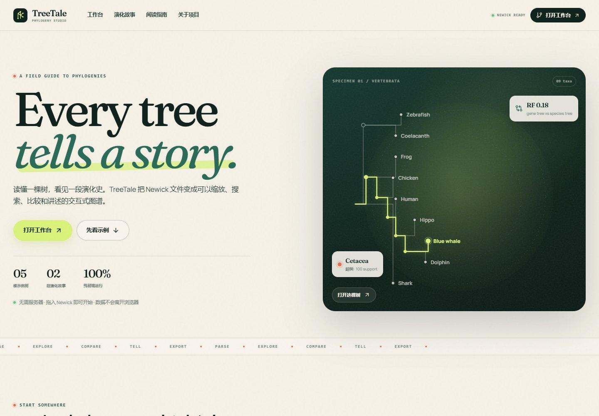
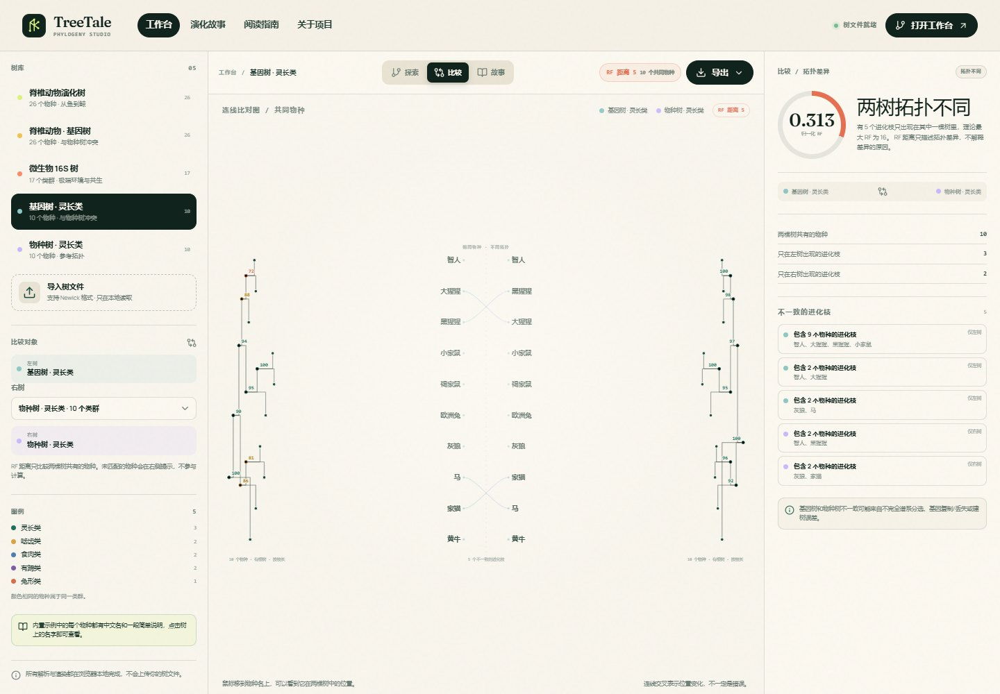
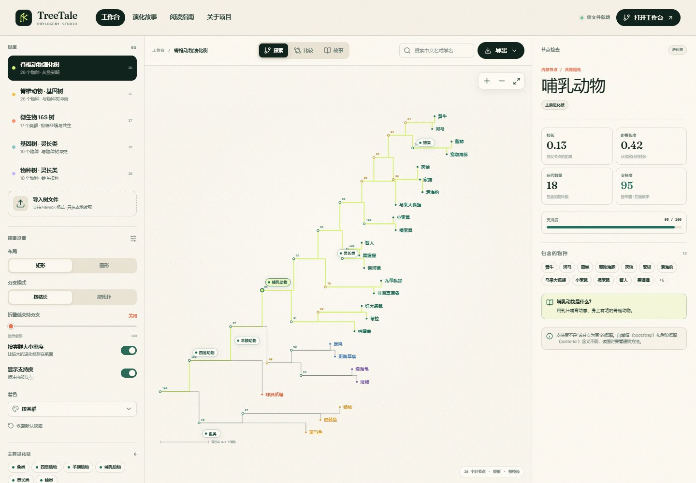
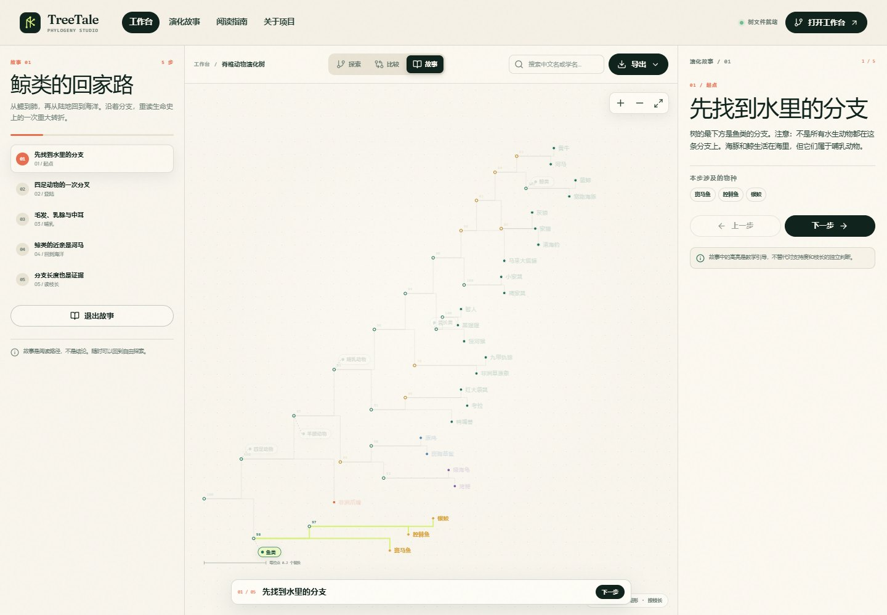

# TreeTale

> **Every tree tells a story.**  
> 把系统发育树变成可以探索、比较和讲述的交互式图谱。

**在线演示：** https://juwairenyixia.github.io/TreeTale/  
[](https://github.com/juwairenyixia/TreeTale/actions/workflows/deploy.yml)

TreeTale 是一个面向生物信息学课程的**纯前端**静态网页项目。它不负责建树，而是负责把已经建好的 Newick 树讲清楚：拖入文件、缩放搜索、检查节点、折叠低支持分支、比较基因树与物种树，并导出 SVG 放进报告。

内置示例树的每个物种都配有**中文名、中文类群、中文生境和初学者说明**。即使没有英文基础，也可以直接点击中文名读树。

<p align="center">
  
</p>

## 功能

### 01 / 解析
- 自己实现的 Newick 递归下降 parser
- 支持引号名称、分支长度、bootstrap support、`[&support=…]` 注释、科学计数法
- 解析失败时给出具体位置和上下文，而不是笼统的“加载失败”
- 一次支持一棵树；多树 NEXUS 建议在上游拆分

### 02 / 中文注释与主要进化枝
- 内置示例的每个物种都有中文名、中文类群、中文生境和一段简单说明
- 5 棵树的主要进化枝都有中文标签：鱼类、四足动物、羊膜动物、哺乳动物、灵长类、鲸类、变形菌门、蓝藻门等
- 标签贴在最近共同祖先旁，自动避让其他标签；点击标签会选中整个进化枝
- 侧栏“主要进化枝”可以快速定位；圆形布局在画布顶部显示标签条
- 点击树上的中文名，右侧显示“中文注释”
- 搜索支持中文名和拉丁学名；输入“蓝鲸”会自动选中并高亮
- 图例、比较、故事和检查器均使用中文功能标签
- 拉丁学名保留在检查器中，并明确标注“学名（拉丁名）”，不要求读者认识英文

### 03 / 探索
- 矩形 / 圆形布局
- 按枝长（Phylogram）/ 按拓扑（Cladogram）分支模式
- 缩放、平移、适应窗口
- 中文名搜索与路径高亮
- 点击任意节点查看：类群、支持度、枝长、根距离、后代物种
- 按支持度阈值折叠低支持分支
- 按类群大小排序、按类群 / 生境着色
- 内置 5 棵示例树；主要进化枝标签自动避让
- 枝长总和小于 1 的树也会正确填满画布，不会被压缩到左侧

### 04 / 比较
- 两棵树并排连线比对图（tanglegram）
- 按物种名自动匹配，支持大小写、下划线与空格归一化
- 计算有根树的 RF 距离（Robinson–Foulds）
- 列出只在左树 / 右树出现的进化枝
- 未匹配物种会明确提示，不把缺失数据当成冲突

<p align="center">
  
</p>

### 05 / 讲述
- 2 段内置引导故事：
  - **鲸类的回家路**：从鱼到四足动物，再到鲸类回到海洋
  - **当两棵树吵架**：基因树与物种树的拓扑冲突
- 每一步自动高亮对应进化枝
- 可从故事直接进入比较模式
- 树、设置、元数据可导出为 Project JSON

### 06 / 导出
- **SVG**：可编辑矢量图，适合报告 / 海报 / 课件
- **PNG**：2× 分辨率
- **Newick**：导出当前折叠/过滤后的树
- **Project JSON**：树、设置、搜索和元数据

## 截图

| 工作台：主要进化枝标签 | 故事模式 |
| --- | --- |
|  |  |

## 快速开始

要求：Node.js 22+、pnpm 11+。

```bash
pnpm install
pnpm dev
```

打开 Vite 提示的本地地址即可。生产构建：

```bash
pnpm test
pnpm build
pnpm preview
```

## 技术栈

- **React 19 + TypeScript + Vite**
- **SVG** 手写树布局与交互，不依赖图表库
- **Fraunces + Manrope** 自托管字体
- **Vitest** 单元测试
- **GitHub Actions + GitHub Pages** 自动部署
- 无后端、无数据库、无 API Key；文件只在浏览器内存中读取

## 目录结构

```text
src/
├── components/
│   ├── CompareView.tsx    # tanglegram + RF 对比
│   ├── HeroTree.tsx       # 首页装饰树
│   ├── Home.tsx           # 首页
│   ├── Inspector.tsx      # 节点 / 故事 / 比较检查器
│   ├── MiniTree.tsx       # 示例卡缩略树
│   ├── Nav.tsx
│   ├── Sidebar.tsx        # 树库、视图设置、故事导航
│   ├── Toast.tsx
│   ├── TreeCanvas.tsx     # 矩形/圆形树画布、缩放、搜索、选择
│   └── Workbench.tsx      # 工作台状态与布局
├── data/
│   └── examples.ts        # 5 棵示例树、中文注释、2 段故事
├── lib/
│   ├── export.ts          # SVG / PNG / 文件下载
│   ├── layout.ts          # 矩形 / 圆形布局
│   ├── newick.ts          # Newick parser 与序列化
│   ├── palette.ts         # 分类着色
│   ├── rf.ts              # RF 距离与进化枝差异
│   └── tree.ts            # 树遍历、最近共同祖先、物种匹配、折叠
├── App.tsx
├── main.tsx
├── styles.css
└── types.ts
```

## 关键实现

### Newick parser

`src/lib/newick.ts` 使用递归下降解析：

```text
tree    := subtree ";"
subtree := "(" subtree ("," subtree)+ ")" [label] [":" length]
         | label [":" length]
```

内部节点上的纯数字标签按 support 处理；`0–1` 的小数按 posterior 归一化到 `0–100`。注释如 `[&support=95]` 也会被读取。

### 树布局

- **矩形 phylogram**：x 轴是根到节点的累计枝长；y 轴按 DFS 叶序分配。
- **矩形 cladogram**：x 轴改为层级深度。
- **圆形布局**：叶节点按角度均分，半径由累计枝长或深度决定；标签沿半径方向旋转，避免 26 个物种时互相重叠。
- 支持度折叠在 `prepareTree()` 中生成 display-only 克隆，不修改原始树。

### RF 距离

比较逻辑在 `src/lib/rf.ts`：

1. 只保留两棵树的共同物种；
2. 收集每棵树的非平凡进化枝（后代叶集合）；
3. 对两个集合做对称差；
4. `RF = |A only| + |B only|`；
5. 以有根二叉树的 `2(n−2)` 归一化。

> RF 只描述拓扑差异，不解释差异来自不完全谱系分选、基因复制/丢失还是建树误差。

### Tanglegram

`CompareView.tsx` 把两棵树的叶节点按物种名匹配，在中央用贝塞尔曲线连接同一物种。连线交叉只表示位置变化，不表示哪棵树“错了”。

## 示例数据说明

仓库内置的树是**教学示例**，用于演示交互和算法，不应作为真实系统发育结论引用：

- **脊椎动物演化树**：26 个物种，拓扑依据公开系统发育关系整理。
- **脊椎动物 · 基因树**：仅移动海豚的位置，用于制造一个可解释的拓扑冲突。
- **微生物 16S 树**：17 个类群，拓扑与分支长度为教学示意。
- **基因树 / 物种树 · 灵长类**：10 个物种，用于演示 RF 和 tanglegram。

如果要在课程报告中引用真实数据，建议从 TreeBASE、Open Tree of Life、NCBI Taxonomy 或论文补充材料获取 Newick 文件，并记录下载日期与许可。

## 测试

```text
src/lib/newick.test.ts        8 tests
src/lib/rf.test.ts            5 tests
src/lib/localization.test.ts  4 tests
src/lib/layout.test.ts        2 tests
```

覆盖：基础解析、引号名称、注释 support、posterior 归一化、科学计数法、错误输入、Newick round-trip、内置树解析、RF 相同/冲突/单边差异、26 个物种比较、每个内置物种的中文名/说明/类群/生境完整性，以及每个主要进化枝标签是否恰好覆盖一个完整进化枝、枝长小于 1 的树是否仍能填满画布。

## 部署到 GitHub Pages

仓库已包含 `.github/workflows/deploy.yml`。

1. 在 GitHub 新建一个空仓库（不要勾选初始化 README）。
2. 在本地推送：

```bash
git remote add origin https://github.com/<你的用户名>/<仓库名>.git
git branch -M main
git push -u origin main
```

3. 打开仓库 **Settings → Pages**，把 **Source** 设为 **GitHub Actions**。
4. 之后每次 push 到 `main` 都会自动运行测试、构建并部署。

`vite.config.ts` 使用 `base: './'`，因此项目页路径（如 `https://username.github.io/treetale/`）也能正常加载资源。

## 已知边界

- 不做序列比对、建树、BLAST 或数据库检索。
- 只支持单棵 Newick；NEXUS 多树需要上游拆分。
- RF 目前按**有根树**的进化枝集合计算；无根树的双分比较是进阶方向。
- 建议单棵树控制在约 2,000 个叶节点以内；更大的树需要 Canvas/WebGL 渲染和虚拟化。
- 支持度阈值是显示过滤，不改变原始树，也不代表统计显著性。

## License

[MIT](LICENSE)
